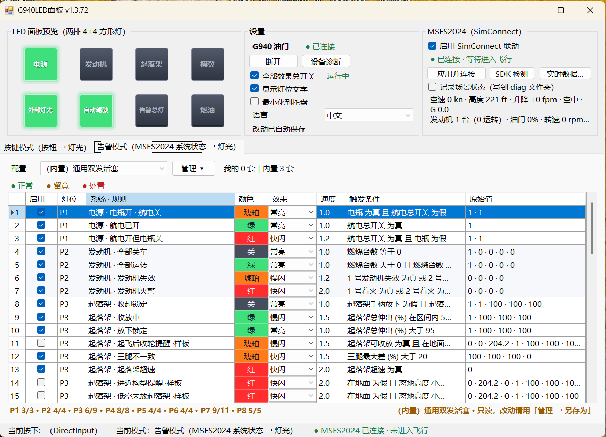

# G940LED面板

为 **Logitech G940 飞行控制器油门底座上的 8 颗 LED 按钮灯** 编写的独立控制程序。

> Independent LED control panel for the 8 backlit buttons on the Logitech G940 throttle base.
> Windows desktop app, .NET Framework 4.8, x64. HID access written from scratch — no third-party native library.

<!-- 界面截图 -->


灯的读写是自研 HID 直写，**不依赖任何第三方原生库**；按钮读取走系统 DirectInput。

## 两种工作模式

- **按键模式**：按下油门底座按钮点亮对应灯位。配置可存多套、互相切换，灯效、颜色、速度、目标灯位都能改。
- **告警模式**：读微软模拟飞行（MSFS2020 / MSFS2024）的 SimConnect 数据，按内置规则判定后点灯——发动机火警、起落架、除冰、失速、燃油等。规则的条件、颜色、效果、速度都能改，也能自己新增。

系统按电源、发动机、起落架、襟翼、外部灯光、自动驾驶、告警总灯、燃油、特种装置、自定义分组，物理灯只有 8 颗：告警模式下**点一下 LED** 就弹出该灯配置框，从各组里挑一组挂上去，未上灯的系统不参与点灯。条件编辑器与实时数据窗里，MSFS 官方已判定的变量标「·官方」。用户新增的规则用蓝色规则名 + 行头色块区分，增删在告警表右键菜单里；配置下拉选中即载入、改动即时写盘，不用点保存。

## 安装与运行

1. 解压到任意目录。**不要放 `C:\Program Files`**——配置写在程序目录里，那里没有写权限，会出现「改完设置下次启动又变回去」。
2. 双击 `G940LedPanel.exe`。**整个目录一起拷**，别只拷 exe：预置配置在 `alerts\builtin\`、`buttons\builtin\` 里，缺了它们配置列表是空白的（程序不会崩）。
3. 程序自动连接 G940 油门；左上角显示连接结果，失败会写明原因。
4. 认不出设备（状态词红「● 未连接」）时，点设置卡片上的「连接」，从列表里选带 P1~P8 灯的那个，选择会被记住。

### 系统要求

| 项目 | 要求 |
|---|---|
| 操作系统 | Windows 10 / 11 |
| 硬件 | Logitech G940 飞行控制器（含油门面板） |
| 驱动 | 系统自带 HID 驱动，无需额外安装 |
| .NET | .NET Framework 4.8（Win10/11 自带） |
| 模拟器联动（可选） | MSFS 自带的 `SimConnect.dll` 等原生库放入 exe 同目录 |

## 文件都在哪

| 路径 | 作用 |
|---|---|
| `G940LedPanel.exe` | 主程序 |
| `config.json` | **本机状态**：上次用哪套配置、窗口位置、滚动位置、相机状态表。界面改动即时写入，不攒到退出 |
| `buttons\*.json` | **按键配置**，一套一个文件。拷给别人 = 拷文件 |
| `alerts\*.json` | **告警配置**，一套一个文件。同上 |
| `buttons\builtin\*.json` | **预置按键配置**（三套演示），随包发出，升级会覆盖 |
| `alerts\builtin\*.json` | **预置告警配置**（通用双发活塞 / 单发活塞 / 喷气支线），同上 |
| `diag\g940-simstate.txt` | 场景状态记录，排查「灯为什么这么亮」，默认不写 |

### 配置怎么分享 / 怎么备份

- **分享一套**：把 `buttons\xxx.json` 或 `alerts\xxx.json` 拷给对方，丢进同名文件夹即可（或界面里「管理 ▾ → 导入」）。
- **整机备份**：整个程序目录拷走，绿色版没有注册表、没有 AppData。
- **改坏了想回退**：每次保存都留了一份同名 `.bak`，把 `.bak` 手工改回 `.json` 就是上一版。
- **预置配置**放在 `builtin\` 里，是普通文件。界面上不能覆盖、不能删除，改动也不会被保存（页脚会亮红字提醒）；想留住改动请用「管理 → 另存为」自己取个名字。
- **直接改预置文件**（记事本打开 json）程序不管，但**升级时整目录覆盖，改动会没**。想长期保留就另存为一份自己的。
- **删了预置文件**列表里就少一套，程序不会重建；要找回就重新解压一份覆盖。

### 换一台电脑

整个目录拷过去即可，只有一件事要确认：认不出设备时点「连接」手选一次。**记的是设备名字不是硬件 ID**——后者是「机器 + USB 口」的指纹，换电脑必然失效且不声不响。

## 界面在哪

- 顶部两个页签：**按键模式** / **告警模式**，点击即时切换。
- 告警页右侧「**MSFS2024（SimConnect）**」面板：勾「启用 SimConnect 联动」才连模拟器；第二行是「场景状态记录」开关，勾上就往 `diag\g940-simstate.txt` 写；下方显示变量摘要和最近一次错误。
- 两个页签的配置区都有「**管理 ▾**」：新建 / 另存为 / 重命名 / 删除 / 导入 / 导出 / 打开配置文件夹。内置配置只能「另存为」。
- 告警页「**新增规则…**」：选系统、起名、挑「排在哪条后面」、设灯色/效果/速度、编辑触发条件。删除只对自己加的规则有效，内置规则用「取消勾选」停用。
- 设置卡片第一行是设备名 + 连接状态（检测中 / 已连接 / 未连接 / 初始化失败 / 已断开）。**鼠标停上去看气泡**：为什么是这个状态、要动手做什么，都写在那里。卡片底部是保存状态，正常为灰色「改动已自动保存」，存不下时变红并写明原因。

## 出问题看哪

| 症状 | 先看 |
|---|---|
| 灯完全不亮 | 灯走独立 HID 通道（C287），与「G940 油门」连接状态无关——那行说的是按钮通道。确认设备管理器里 G940 正常，再用「设备诊断 → HID 探针」看列表里有没有 C287；写 HID 被拒时用管理员身份再试 |
| 灯在菜单画面乱闪 / 座舱里该亮不亮 | 开「场景状态记录」，复现一次，把 `diag\g940-simstate.txt` 拿出来——里面有时间戳、相机状态值和当时判定 |
| 改完设置重开就没了 | 程序是否放在 `C:\Program Files`；卡片底部会亮红「⚠ 配置存不下」，悬停看原因 |
| 换台电脑后认不出设备 | 确认设备管理器里能看到 G940，再点「连接」手动选一次 |
| 想知道灯为什么是这个状态 | 设备诊断 → 「HID 探针」，只读不改。对 Feature 3 会直接翻成「红点亮了哪几颗 / 绿点亮了哪几颗」，可复制或导出 |
| 灯亮着但不知道哪条设置让它亮 | 鼠标停在灯上：按键模式列出绑到这颗灯的按钮，告警模式列出命中的规则，都带「第 N 行」 |
| 灯亮但颜色不对（该红亮绿） | 红/绿位图弄反了。先看 HID 探针 Feature 3 那行的翻译（正常全绿应读回 `03 00 FF 00 00`） |
| 想自己点一次灯验证通道 | 另有独立点灯自测程序 `G940LedTest`，不依赖主程序，**单独发布、不在本包内** |

## 从源码构建

只有两个 NuGet 依赖（`System.Text.Json`、`Microsoft.NETFramework.ReferenceAssemblies`），
**首次编译需要联网还原**，之后可离线。代码最低只需 C# 7.3，不必追新编译器。

### Windows / Visual Studio

环境：**Visual Studio 2022**（或 2019 16.8+），安装时勾选「.NET 桌面开发」与「.NET Framework 4.8 目标包」。

打开 `G940LedPanel.sln` → 直接生成。`Debug` / `Release` 均可，输出在
`G940LedPanel-src\bin\<配置>\net48\`，按 F5 即可运行。

### 命令行 / Linux / macOS

环境：**.NET SDK 6.0 以上**（实测 6.0.301 通过）。Linux 不必装 Mono，net48 的引用程序集
由 `Microsoft.NETFramework.ReferenceAssemblies` 包自动提供。

```bash
dotnet build G940LedPanel.sln -c Release
# 输出：G940LedPanel-src/bin/Release/net48/G940LedPanel.exe
```

### 三个容易踩的坑

1. **不能只拷 exe**。`System.Text.Json` 带 7 个依赖 dll（`System.Memory`、`System.Buffers` 等），必须连同整个输出目录一起拷走，否则启动即崩。
2. **Linux / macOS 编出来的 exe 不能在 Linux / macOS 跑**。WinForms + .NET Framework 只能在 Windows 运行，交叉编译只用于验证「代码能编过」。
3. **首次还原要联网**。网络若拦了 nuget.org，需配代理或私有源，否则 `restore` 阶段就失败。

## 仓库结构

```
G940LedPanel/
├── G940LedPanel.sln                   解决方案（单工程）
├── G940LedPanel-src/
│   ├── Core/                          规则、条件求值、配置读写、HID 直写、SimConnect 封装
│   ├── Effects/                       EffectEngine / LedCompositor / LedEffect / LedLayout
│   ├── UI/                            10 个窗体（含 Designer）+ 语言表 / 配色 / 指示灯控件
│   ├── alerts/builtin/                预置告警规则：双发活塞 / 单发活塞 / 喷气支线
│   ├── buttons/builtin/               预置按键配置：三套演示
│   ├── G940LedPanel.csproj            版本号的唯一真源
│   ├── Program.cs                     入口、单实例互斥、全局异常兜底
│   ├── Strings.resx / Strings.en-US.resx    中英文语言包
│   ├── app.manifest                   高 DPI 感知声明
│   └── THIRD-PARTY-NOTICES.md
├── .github/workflows/
│   ├── ci.yml                         每次推送自动编译验证
│   └── release.yml                    打 tag 自动出包并发布到 Releases
├── README.md
└── LICENSE
```

分层是单向的：`UI → Effects / Core`，`Core` 不引用任何界面类型，所以规则求值、状态机这类逻辑
不依赖窗口也能验证。版本号三段式、唯一来源是 `G940LedPanel.csproj` 的 `<Version>`，标题栏、
托盘、关于框都从程序集版本读，不手写。

## 许可

MIT，见 [LICENSE](LICENSE)。第三方组件声明见 `G940LedPanel-src/THIRD-PARTY-NOTICES.md`。

## 打赏

<!-- 爱发电开通后取消注释
如果这个项目帮你把灯点亮了，可以 [请我喝杯咖啡](https://afdian.com/a/你的ID)。
-->

暂未开通。用着顺手就点个 Star，这比什么都实在。

## 致谢

这个项目站在公开资料上做成：微软 SimConnect 的官方 C API 文档，以及社区对 G940 油门面板 HID
通道（LED 走独立的 C287 通道、Feature 3 报灯状态）的逆向整理。没有这些公开信息，灯的读写无从下手。
所以代码也公开回去。

非官方项目，与 Logitech / Saitek / Microsoft 均无关联。G940、SimConnect、MSFS 等名称归各自权利人所有。
